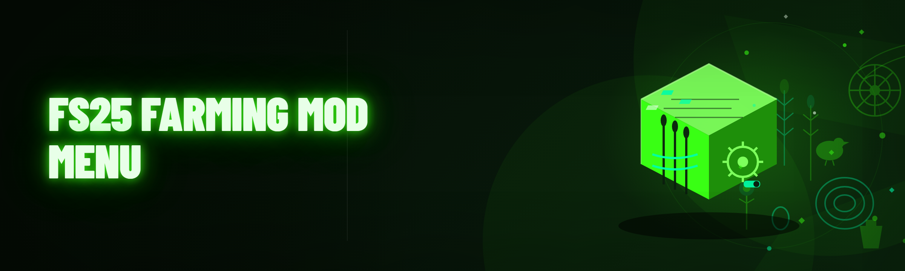

  
  
  

  

  
  
  

---

FS25 Farming Mod Menu: money & XP multiplier, teleport, vehicle spawner, speed hack, field auto-work toggles — Lua script for Farming Simulator 25.

## Overview

FS25 Farming Mod Menu: money & XP multiplier, teleport, vehicle spawner, speed hack, field auto-work toggles — Lua script for Farming Simulator 25.

  

## License

[MIT License](LICENSE)

  

